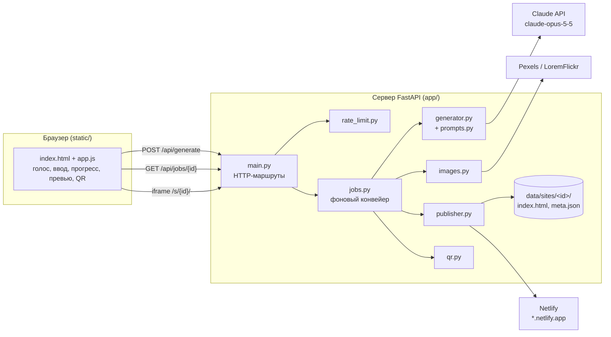
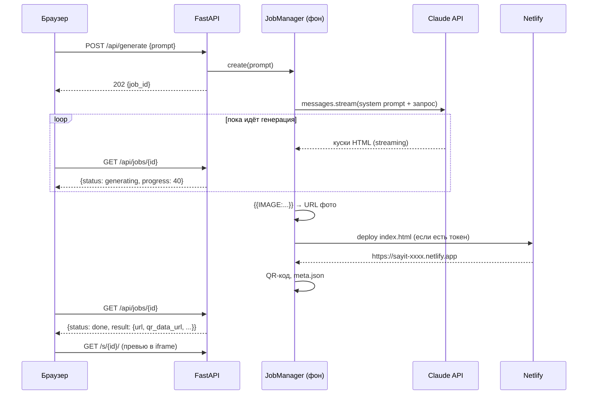

# 🎤 Say IT — сайт за минуту голосом

> **«Say it → Live»**: айттың — сайт іске қосылды.

Скажите в микрофон: *«Создай сайт для кофейни в Алматы: меню, цены, форма бронирования»* —
через 30–60 секунд Say IT покажет готовый сайт, даст на него **ссылку** и **QR-код**.
Наведите камеру телефона на QR, и сайт откроется. Программировать не нужно.

---

## Содержание

1. [Что умеет](#-что-умеет)
2. [Быстрый старт (5 минут)](#-быстрый-старт-5-минут)
3. [Как открыть сайт с телефона](#-как-открыть-сайт-с-телефона-qr)
4. [Как это работает (простыми словами)](#-как-это-работает-простыми-словами)
5. [Архитектура](#-архитектура)
6. [Структура проекта](#-структура-проекта)
7. [API](#-api)
8. [Настройки (.env)](#-настройки-env)
9. [Тесты](#-тесты)
10. [Деплой в интернет](#-деплой-в-интернет)
11. [Частые проблемы](#-частые-проблемы)
12. [Что можно улучшить](#-что-можно-улучшить)

---

## ✨ Что умеет

| Функция | Как реализовано |
|---|---|
| 🎤 Голосовой ввод (русский, қазақша, English) | Web Speech API браузера (Chrome / Edge / Safari) |
| 📝 Текстовый ввод + примеры запросов | Поле на 2000 символов, `Ctrl+Enter` — отправить |
| 🤖 Генерация сайта ИИ | Claude (`claude-opus-5-5`) пишет полный HTML/CSS/JS |
| 🖼️ Подходящие картинки | ИИ пишет ключевые слова → фото с Pexels или LoremFlickr |
| 📱 Адаптивная вёрстка | Требование в промпте + проверка в превью «ПК / планшет / телефон» |
| ⏳ Статус генерации | Этапы, прогресс-бар, таймер, счётчик написанного кода |
| 👀 Предпросмотр | iframe прямо в сервисе + кнопка «Открыть ↗» |
| 🔗 Ссылка и QR-код | Копирование в один клик, скачивание QR в PNG |
| 🌍 Публикация в интернете | Netlify (`*.netlify.app`) или сам сервер (`/s/<id>/`) |

---

## 🚀 Быстрый старт (5 минут)

### 0. Что нужно установить

- **Python 3.10+** — [python.org/downloads](https://www.python.org/downloads/)
  (на Windows при установке отметьте галочку **«Add Python to PATH»**).
- **Git** — [git-scm.com](https://git-scm.com/).
- **Ключ Claude API** — зарегистрируйтесь на [console.anthropic.com](https://console.anthropic.com/settings/keys)
  и создайте ключ (начинается с `sk-ant-...`).

Проверить: `python --version` и `git --version` должны вывести версии.

### 1. Скачать проект

```bash
git clone <ссылка-на-репозиторий> say-it
cd say-it
```

### 2. Создать виртуальное окружение и поставить зависимости

Виртуальное окружение (`.venv`) — это отдельная папка с библиотеками только для этого проекта.

**Windows (PowerShell):**

```powershell
python -m venv .venv
.\.venv\Scripts\Activate.ps1
pip install -r requirements-dev.txt
```

> Если PowerShell ругается на «execution policy», выполните один раз:
> `Set-ExecutionPolicy -Scope CurrentUser RemoteSigned`

**macOS / Linux:**

```bash
python3 -m venv .venv
source .venv/bin/activate
pip install -r requirements-dev.txt
```

После активации в начале строки терминала появится `(.venv)`.

### 3. Указать ключи

Скопируйте пример настроек и впишите свой ключ:

```bash
cp .env.example .env        # Windows: copy .env.example .env
```

Откройте `.env` и заполните хотя бы одну строку:

```
ANTHROPIC_API_KEY=sk-ant-ваш-ключ
```

### 4. Запустить

```bash
python -m app
```

Откройте в браузере **http://localhost:8000** — готово! 🎉

> Для разработки удобно включить автоперезапуск при изменении кода: `RELOAD=true` в `.env`.
> Автодокументация API: **http://localhost:8000/docs**.

---

## 📱 Как открыть сайт с телефона (QR)

QR-код ведёт на ссылку сайта. Адрес `localhost` есть только на вашем компьютере,
поэтому телефон его не откроет. Есть три варианта, от лучшего к простому:

| Вариант | Что сделать | Плюсы |
|---|---|---|
| **A. Netlify** (лучший для демо и жюри) | Создайте токен: Netlify → User settings → Applications → *Personal access tokens*. Впишите `NETLIFY_TOKEN=...` в `.env` | Каждый сайт получает свой адрес `https://sayit-xxxx.netlify.app`, который работает из любой сети |
| **B. Та же Wi-Fi сеть** | Узнайте IP компьютера (`ipconfig` на Windows, `ifconfig` на macOS), например `192.168.1.15`. Впишите `PUBLIC_BASE_URL=http://192.168.1.15:8000`. Разрешите Python в брандмауэре | Ничего не нужно регистрировать |
| **C. Туннель** | `cloudflared tunnel --url http://localhost:8000` или `ngrok http 8000`, полученный `https://...` адрес впишите в `PUBLIC_BASE_URL` | Работает из любой сети, есть HTTPS |

> 💡 Голосовой ввод в браузере работает только на `localhost` или по `https://`.
> Если открываете сервис по IP (вариант B), голос будет недоступен — используйте вариант C.

---

## 🧠 Как это работает (простыми словами)

1. **Вы говорите.** Браузер сам превращает речь в текст (Web Speech API) и вставляет его в поле.
2. **Нажимаете «Создать сайт».** Браузер отправляет текст на наш сервер: `POST /api/generate`.
3. **Сервер создаёт задачу** и сразу отвечает её номером, а работа идёт в фоне.
4. **Claude пишет сайт.** Сервер отправляет в Claude API ваш запрос и подробную инструкцию
   ([app/prompts.py](app/prompts.py)): «один HTML-файл, современный дизайн, адаптивность,
   рабочие формы, текст на языке запроса». Ответ приходит **потоком** (streaming),
   поэтому мы видим, сколько кода уже написано, и двигаем прогресс-бар.
5. **Подставляем картинки.** ИИ не умеет рисовать файлы, поэтому вместо фото он пишет метки
   вида `{{IMAGE:latte art coffee|800x600}}`. Сервер заменяет каждую метку настоящим фото
   по ключевым словам ([app/images.py](app/images.py)).
6. **Публикуем.** HTML сохраняется в `data/sites/<id>/index.html` и (если есть токен) загружается
   на Netlify ([app/publisher.py](app/publisher.py)).
7. **Делаем QR-код** со ссылкой ([app/qr.py](app/qr.py)).
8. **Браузер всё это время спрашивает** `GET /api/jobs/<id>` раз в секунду (polling) и показывает
   этапы. Когда статус `done`, открывается экран с превью, ссылкой и QR.

---

## 🏗 Архитектура

### Общая схема



### Жизненный цикл одного запроса



### Ключевые решения

| Решение | Почему |
|---|---|
| **Polling вместо WebSocket** | Проще понять и отладить, работает за любым прокси. Опрос раз в секунду почти не нагружает сервер. |
| **Один HTML-файл на сайт** | Его легко опубликовать где угодно (Netlify, свой сервер, GitHub Pages) одним запросом. |
| **Плейсхолдеры картинок** | ИИ не генерирует файлы, зато хорошо подбирает ключевые слова. Замена — обычная строковая операция. |
| **Зависимости передаются в `create_app()`** | Тесты подменяют Claude фейковым генератором: нет трат и нет интернета. |
| **`effort: low` по умолчанию** | Модель меньше «размышляет» и отвечает быстрее, укладываемся в 30–60 с. |
| **`fallbacks: "default"`** | Если фильтр безопасности ошибочно отклонит запрос, API сам повторит его на запасной модели. |
| **Задачи в памяти** | Для MVP хватает. После перезапуска сервера список задач пропадёт, но сами сайты останутся на диске. |

### Безопасность

- **Песочница для сгенерированных сайтов.** `/s/<id>/` отдаётся с заголовком
  `Content-Security-Policy: sandbox ...`, а превью показано в `<iframe sandbox>`. Скрипты
  сгенерированного сайта работают в «чужом» origin и не могут вызывать наш API или читать данные сервиса.
- **Проверка `site_id`** регулярным выражением `^[a-z0-9]{6,32}$`, поэтому выйти за пределы папки (`../`) нельзя.
- **Ограничения:** длина запроса 3–2000 символов, лимит запросов с одного IP
  (по умолчанию 5 за 10 минут), не больше 3 генераций одновременно.
- **Секреты** хранятся только в `.env` (он в `.gitignore`). Внутренние ошибки не показываются пользователю.

---

## 📁 Структура проекта

```
say-it/
├── app/                    # Backend (Python)
│   ├── __main__.py         # Точка входа: `python -m app` запускает сервер
│   ├── main.py             # FastAPI: все HTTP-маршруты, сборка приложения create_app()
│   ├── config.py           # Настройки из .env (класс Settings)
│   ├── prompts.py          # Инструкция для Claude: каким должен быть сайт
│   ├── generator.py        # Вызов Claude API (streaming, ошибки, отказы)
│   ├── html_utils.py       # Достаёт чистый HTML из ответа модели, читает <title>
│   ├── images.py           # {{IMAGE:...}} → реальные фото (Pexels / LoremFlickr)
│   ├── publisher.py        # Хранение на диске + публикация (локально / Netlify)
│   ├── qr.py               # Генерация QR-кода в PNG
│   ├── jobs.py             # Фоновые задачи: генерация → картинки → публикация → QR
│   └── rate_limit.py       # Ограничение частоты запросов по IP
├── static/                 # Frontend (без сборки, просто файлы)
│   ├── index.html          # Три экрана: ввод, загрузка, результат
│   ├── styles.css          # Стили (светлая/тёмная тема, адаптивность)
│   ├── app.js              # Логика: голос, отправка, polling, превью, копирование
│   └── logo.svg            # Логотип
├── tests/                  # Автотесты (pytest), без реальных API-вызовов
├── docs/PLAN.md            # План разработки
├── data/                   # Сгенерированные сайты (создаётся автоматически, не в git)
├── .env.example            # Пример настроек
├── requirements.txt        # Зависимости для запуска
├── requirements-dev.txt    # + зависимости для тестов
└── pyproject.toml          # Настройки pytest
```

**С чего начать чтение кода:** `app/main.py` → `app/jobs.py` → `app/generator.py` → `static/app.js`.

---

## 🔌 API

Интерактивная документация доступна на `/docs` (Swagger UI).

| Метод | Путь | Ответ |
|---|---|---|
| `GET` | `/` | Интерфейс сервиса |
| `GET` | `/api/health` | `{"status": "ok", "publisher": "local" \| "netlify"}` |
| `POST` | `/api/generate` | Тело `{"prompt": "..."}` → `202 {"job_id": "..."}`; `422` — неверный запрос, `429` — лимит |
| `GET` | `/api/jobs/{job_id}` | Статус задачи (пример ниже) |
| `GET` | `/api/sites/{site_id}/qr.png` | QR-код PNG (скачивание) |
| `GET` | `/s/{site_id}/` | Сам сгенерированный сайт |

Пример ответа `GET /api/jobs/{id}` после завершения:

```json
{
  "id": "ccW2wYq4j-rc",
  "status": "done",
  "message": "Готово!",
  "progress": 100,
  "chars": 24817,
  "elapsed_seconds": 41.3,
  "error": null,
  "result": {
    "site_id": "k3x9q2m7ab",
    "url": "https://sayit-k3x9q2m7ab.netlify.app",
    "preview_url": "/s/k3x9q2m7ab/",
    "title": "Кофейня Арома — Алматы",
    "provider": "netlify",
    "warning": null,
    "qr_data_url": "data:image/png;base64,iVBORw0...",
    "qr_download_url": "/api/sites/k3x9q2m7ab/qr.png"
  }
}
```

Статусы: `queued` → `generating` → `images` → `publishing` → `done` (или `error` с текстом в `error`).

---

## ⚙️ Настройки (.env)

| Переменная | По умолчанию | Описание |
|---|---|---|
| `ANTHROPIC_API_KEY` | — | **Обязательно.** Ключ Claude API |
| `NETLIFY_TOKEN` | — | Публиковать сайты на Netlify |
| `PUBLIC_BASE_URL` | адрес из запроса | Публичный адрес сервера для ссылок и QR |
| `PEXELS_API_KEY` | — | Качественные фото с Pexels |
| `CLAUDE_MODEL` | `claude-opus-5-5` | Модель Claude |
| `CLAUDE_EFFORT` | `low` | `low` / `medium` / `high`: скорость против тщательности |
| `CLAUDE_FAST_MODE` | `false` | До 2.5× быстрее, но в 2 раза дороже |
| `CLAUDE_MAX_TOKENS` | `32000` | Максимальная длина ответа |
| `HOST` / `PORT` | `0.0.0.0` / `8000` | Где слушает сервер |
| `RELOAD` | `false` | Автоперезапуск при изменении кода |
| `FORWARDED_ALLOW_IPS` | `127.0.0.1` | Доверенные прокси (`*` на Render/Railway) |
| `DATA_DIR` | `data` | Папка для сайтов |
| `RATE_LIMIT_REQUESTS` | `5` | Генераций с одного IP за окно (`0` = без лимита) |
| `RATE_LIMIT_WINDOW_SECONDS` | `600` | Окно лимита в секундах |
| `MAX_CONCURRENT_JOBS` | `3` | Одновременных генераций |

---

## 🧪 Тесты

```bash
pytest
```

45 тестов выполняются меньше чем за секунду и **не тратят деньги**: Claude заменён фейковым
генератором, Netlify и Pexels заменены `httpx.MockTransport`.

| Файл | Что проверяет |
|---|---|
| `test_html_utils.py` | Извлечение HTML из ответа модели, обрезанные ответы, `<title>` |
| `test_images.py` | Поиск меток картинок, Pexels, запасной вариант при ошибке |
| `test_publisher.py` | Сохранение на диск, деплой на Netlify, откат при сбое Netlify |
| `test_qr.py` | QR-код — настоящий PNG |
| `test_rate_limit.py` | Лимит запросов и окно времени |
| `test_generator.py` | Параметры запроса к Claude, streaming, отказ модели |
| `test_api.py` | Весь сценарий через HTTP: генерация → статус → сайт → QR, ошибки 404/422/429 |

Проект сделан по TDD: сначала написаны тесты (см. историю коммитов), затем код.

---

## ☁️ Деплой в интернет

Пример для **[Render](https://render.com)** (есть бесплатный тариф):

1. Загрузите репозиторий на GitHub.
2. Render → **New → Web Service** → выберите репозиторий.
3. **Build command:** `pip install -r requirements.txt`
4. **Start command:** `python -m app`
5. **Environment:** `ANTHROPIC_API_KEY`, `NETLIFY_TOKEN`, `FORWARDED_ALLOW_IPS=*`,
   `PUBLIC_BASE_URL=https://<ваш-сервис>.onrender.com`.

> ⚠️ Диск на бесплатных хостингах стирается при перезапуске. С `NETLIFY_TOKEN` сайты
> живут на Netlify и не пропадают, поэтому для продакшна это рекомендуемый вариант.

Так же запускается на Railway, Fly.io или любом VPS (`python -m app`).

---

## 🩺 Частые проблемы

| Симптом | Решение |
|---|---|
| «Не задан ANTHROPIC_API_KEY» | Создайте `.env` из `.env.example` и впишите ключ, перезапустите сервер |
| «Неверный или отсутствующий ANTHROPIC_API_KEY» | Ключ скопирован с ошибкой или отозван. Создайте новый в консоли Anthropic |
| Кнопка 🎤 неактивна | Откройте в Chrome или Edge. Голос работает только на `localhost` или по `https://` |
| «Разрешите доступ к микрофону» | Нажмите 🔒 в адресной строке → Микрофон → Разрешить |
| QR не открывается на телефоне | Ссылка указывает на `localhost`. См. раздел [«Как открыть с телефона»](#-как-открыть-сайт-с-телефона-qr) |
| Генерация дольше минуты | Нормально для больших сайтов. Ускорить: `CLAUDE_FAST_MODE=true` или более короткий запрос |
| «Слишком много запросов» | Сработал лимит. Подождите или увеличьте `RATE_LIMIT_REQUESTS` |
| Картинки не по теме | Добавьте `PEXELS_API_KEY`: подбор у Pexels точнее |
| `python` не найден (Windows) | Переустановите Python с галочкой «Add Python to PATH» или используйте `py` |

---

## 🛣 Что можно улучшить

- ✏️ Правки голосом: «сделай фон темнее», «добавь раздел с отзывами» (повторный запрос с текущим HTML).
- 🐙 Публикация на GitHub Pages как альтернатива Netlify.
- 💾 Хранить задачи в SQLite/Redis, чтобы они переживали перезапуск.
- 🗣 Серверное распознавание речи для браузеров без Web Speech API (Firefox).
- 👤 Аккаунты и история созданных сайтов.

---

Сделано командой **Say IT** · Генерация на базе [Claude](https://www.anthropic.com/claude)
